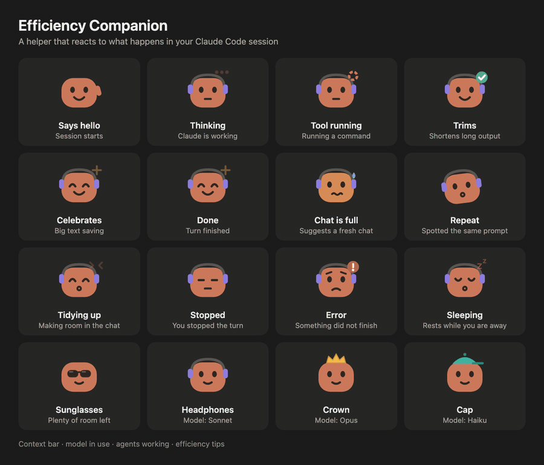

# Efficiency Companion



A small helper above the typing box in Claude Desktop (Code tab) that keeps your chats light.

- **Chat space:** a colour bar and percentage show how full the chat is. It suggests a fresh chat when it gets long, and offers **Start fresh** (a handoff you can review) or **Stay here** (make room).
- **Model and agents:** a pill shows the model in use. When other agents are working, a second pill on the right shows how many.
- **Reacts to what is happening:** waves hello, thinks while Claude works, watches tools run, celebrates a big trim, rests when you are away, and shows a calm or concerned face when a turn stops or fails. It wears sunglasses when there is plenty of room, and an accessory for the model: headphones (Sonnet), crown (Opus), cap (Haiku).
- **Short tips:** only when they apply, for example when you are on Opus or using high effort. Click **Got it** to hide one.
- **Shorter command output:** long, noisy output (build logs, test runs) is shortened before it uses your context. The full original is always kept and can be restored.

**Details** (next to the helper) shows chat space, estimated cost, and what has been shortened. **Pause animation** is in there too. The helper also stops moving when your system has Reduce Motion on.

In Claude Desktop the helper is a small drawing. In the terminal, which can only show text, it is a text face such as `(•‿•)` that changes with each state.

Everything runs on your computer. No model calls, no network.

## Cost and pricing

- **Cost line (in Details):** the plugin does not calculate it. It shows the cost figure Claude Code itself reports for this chat (the same one its status line uses), so treat it as Claude Code's estimate, not an invoice.
- **Opus tip:** based on list prices per million tokens (input / output), checked on 2026-10-07 at https://platform.claude.com/docs/en/about-claude/pricing

| Model | Input | Output |
| --- | --- | --- |
| Opus 5.5 | $4 | $20 |
| Opus 5 and 4.x | $5 | $25 |
| Sonnet 5.5 | $2 | $10 |
| Haiku 4.5 | $1 | $5 |

  Opus 5.5 is exactly twice Sonnet 5.5. Older Opus versions are 2.5 times. This compares price per token only. Real cost also depends on how many tokens a task uses, and prices can change, so check the page above.
- **Fresh-chat suggestion:** it always says why: a message repeated, the chat is full (75% by default), or you passed 30 messages and the chat is at least half full. Details repeats the rule.

## Install

You need Claude Code with plugin support (Claude Desktop, Code tab, or the terminal).

```sh
git clone https://github.com/aiagui/efficiency-companion.git
claude plugin marketplace add ./efficiency-companion
claude plugin install efficiency-companion@efficiency-companion
```

Or point `marketplace add` at this repo URL once Claude accepts remote marketplaces.

Then restart Claude. To remove it: `claude plugin uninstall efficiency-companion`.

## Commands

| Command | What it does |
| --- | --- |
| `/efficiency-open` | Show the helper above the typing box |
| `/efficiency-stats` | Show what has been shortened (add `json` for raw numbers) |
| `/efficiency-original <id>` | Restore a shortened output in full |
| `/efficiency-bypass` | Keep the next tool output complete |
| `/efficiency-draft` | Write a handoff you can take to a fresh chat |
| `/efficiency-purge confirm` | Delete saved originals and stats |

The plugin also includes five skills that work in ordinary chat: `efficiency-check`, `efficiency-handoff`, `efficiency-pack`, `efficiency-cleaner` and `efficiency-panel`.

## Settings

Change them with `/plugin configure efficiency-companion@efficiency-companion`. See `config/settings.example.json` for the defaults.

| Setting | Default | Meaning |
| --- | --- | --- |
| `enabled` | on | Turn the helper on or off |
| `mode` | apply | `apply` shortens output. `observe` only measures |
| `skin` | orange | Helper colour: orange, blue, green or purple |
| `animateCompanion` | on | Let the helper move. Reduce Motion always wins |
| `tips` | on | Show efficiency tips |
| `contextPercent` | 75 | Suggest a fresh chat when the chat is this full |
| `maxTurns` | 30 | Or after this many of your messages, once the chat is at least half full |
| `redactSecrets` | off | Mask likely passwords and keys in output |
| `minBytes` | 2048 | Only shorten output longer than this |
| `diffContextReduction` | off | Also shorten unchanged lines in git diffs |
| `duplicateThreshold` | 3 | Warn after this many repeated reads of one file |
| `archiveBudgetBytes` | 2000000 | Space for keeping originals |
| `maxCacheEntries` | 256 | Recent file reads remembered |
| `telemetry` | on | Keep simple counts on this computer only |

## Develop

```sh
npm test                 # unit and integration tests
claude plugin validate . # check the plugin
claude plugin test .     # run the pane tests
```

Source: `hooks/register.js` (the helper and its events), `src/companion.js` (the drawing), `src/status.js` (bar, pills, wording), `src/tips.js` (tips), `src/core.js` (output shortening).

MIT licence.
